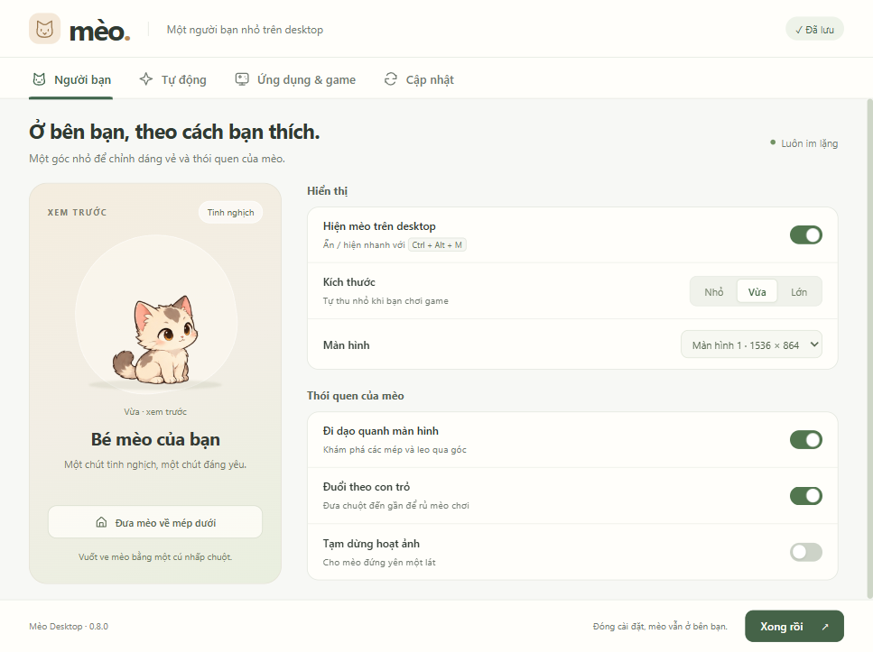
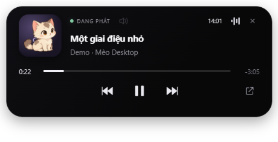
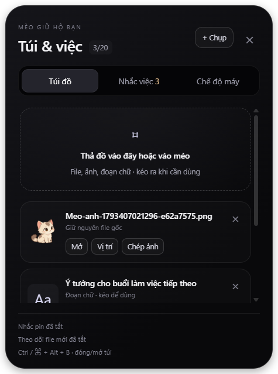

<p align="center">
  
</p>

# Mèo Desktop

Một người bạn mèo 2D nhỏ trên màn hình dành cho người dùng **Windows và macOS**: đi dạo, nghe nhạc cùng bạn và giữ hộ ảnh chụp. App hoàn toàn im lặng, giúp những thao tác nhỏ hằng ngày trở nên thú vị hơn.

[](https://github.com/duytienkaka/meo-desktop/releases)
[](https://github.com/duytienkaka/meo-desktop/actions/workflows/ci.yml)
[](#downloads)

**[Tải xuống](#downloads)** · [Xem trước](#preview) · [Tính năng](#features) · [Cài đặt từ source](#development) · [Đóng góp](#contributing)

<a id="preview"></a>

## Xem trước



<details>
<summary>Xem card điều khiển nhạc</summary>



Ảnh chụp từ giao diện Windows; tên bài, ảnh bìa và trình phát trong hình là dữ liệu demo.

</details>

<details>
<summary>Xem Túi & việc</summary>



Ảnh giao diện với file, chữ và trạng thái pin giả lập dùng để kiểm tra; không phải dữ liệu người dùng thật.

</details>

<a id="downloads"></a>

## Tải xuống và cài ứng dụng

**Bản hiện tại: 0.10.0 — Preview. Người dùng cài app không cần Node.js hay công cụ lập trình.**

| Máy của bạn | Bấm để tải | Yêu cầu |
| --- | --- | --- |
| Windows 64-bit | **[⬇ Tải bộ cài Windows (.exe)](https://github.com/duytienkaka/meo-desktop/releases/download/v0.10.0/Meo-Desktop-Setup-0.10.0-x64.exe)** | Windows 10/11, x64 |
| Mac Apple Silicon — M1 trở lên | **[⬇ Tải bản Mac Apple Silicon (.dmg)](https://github.com/duytienkaka/meo-desktop/releases/download/v0.10.0/Meo-Desktop-0.10.0-mac-arm64.dmg)** | macOS 13 Ventura trở lên |
| Mac Intel | **[⬇ Tải bản Mac Intel (.dmg)](https://github.com/duytienkaka/meo-desktop/releases/download/v0.10.0/Meo-Desktop-0.10.0-mac-x64.dmg)** | macOS 13 Ventura trở lên |

[Xem Release 0.10.0 và SHA-256](https://github.com/duytienkaka/meo-desktop/releases/tag/v0.10.0) · [Tất cả phiên bản](https://github.com/duytienkaka/meo-desktop/releases)

1. Chọn đúng bộ cài trong bảng. Trên Mac, xem loại chip tại menu Apple → **About This Mac** nếu chưa biết chọn bản nào.
2. **Windows:** mở `.exe` và làm theo trình cài đặt. **Mac:** mở `.dmg`, kéo **Meo.app** vào **Applications**, rồi mở app từ đó.
3. Chỉnh mèo trong cửa sổ **Cài đặt**. Khi đóng cửa sổ này, mèo vẫn hoạt động trong khay hệ thống/thanh menu.

> Bản Windows chưa ký số; bản Mac ký ad-hoc, **chưa Developer ID / Apple notarization**. Hệ điều hành có thể cảnh báo hoặc chặn mở. Trên Mac, kiểm tra nguồn tải và mục **System Settings → Privacy & Security** trước khi quyết định cho phép mở; không cần tắt Gatekeeper.

<a id="features"></a>

<details>


</details>

## Tính năng chính

- **Mèo trên desktop:** đi dạo theo mép, rình/vồ con trỏ, phản ứng khi vuốt ve; giữ và kéo để đặt ở vị trí bạn muốn.
- **Nghe nhạc cùng bạn:** nhấp mèo để mở/đóng card nhạc, phát/dừng/chuyển bài, tua khi được hỗ trợ và mở trình phát.
- **Điều khiển âm lượng:** cuộn trên mèo để tăng/giảm âm lượng hệ thống, bấm nút loa để bật/tắt tiếng.
- **Giữ tối đa 3 ảnh:** chụp vùng màn hình, để mèo cầm xấp ảnh rồi đưa cả bộ vào bản nháp bằng một nút.
- **Túi đồ:** giữ tối đa 20 file, thư mục, ảnh và đoạn chữ; kéo tên / ảnh ra app khác, sao chép chữ, mở file hoặc tìm vị trí. Không di chuyển file gốc.
- **Nhắc việc:** nhập thời gian bằng tiếng Việt, mèo cầm biển khi đến giờ; hoàn thành hoặc nhắc lại sau 10 phút. Lưu qua lần mở app.
- **Pin và file mới:** mèo ôm pin khi còn 20% hoặc thấp hơn, phản ứng khi cắm sạc; nhận file mới ổn định trong Downloads vào túi. Có thể tắt hoặc chọn thư mục khác.
- **Chế độ máy:** Làm việc và Thư giãn; mỗi chế độ nhớ âm lượng, app cần mở và cách mèo xuất hiện.
- **Ứng dụng đã ghim:** ghim tối đa 20 ứng dụng để mở nhanh hoặc gắn vào chế độ máy.
- **Mở cùng máy tính:** tùy chọn chạy nền khi đăng nhập, mặc định tắt.
- **Cập nhật phiên bản:** kiểm tra bản mới trên GitHub Releases, hiển thị trạng thái trong Cài đặt → Cập nhật; Windows tải/cài khi bạn chọn, Mac tải đúng DMG theo chip.

Các thay đổi source chưa có trong bộ cài 0.10.0: bỏ chế độ game và nhận thông báo hệ thống; thêm 12 tư thế tương tác vẽ toàn thân theo dáng mèo cũ. Các tư thế mới dùng một hình mèo hoàn chỉnh, không ghép thêm chân. Bộ đi lại, nhảy và nghe nhạc cũ được giữ nguyên.

## Công nghệ sử dụng

| Thành phần | Công nghệ |
| --- | --- |
| Ứng dụng desktop | Electron 45, JavaScript/Node.js |
| Giao diện và hoạt ảnh | HTML, CSS, Canvas 2D |
| Tích hợp Windows | C#/.NET Framework, API hệ thống Windows |
| Tích hợp macOS | Swift, JXA, AppKit |
| Cập nhật và đóng gói | electron-updater, electron-builder, GitHub Releases |
| Kiểm thử và CI | node:test, Playwright, GitHub Actions |
| Lưu cấu hình | JSON trên máy; không cần server/database riêng |

<a id="usage"></a>

## Cách sử dụng

### Thao tác thường ngày

- **Nhấp mèo:** tương tác với mèo hoặc mở/đóng card nhạc khi có phiên nhạc.
- **Giữ và kéo:** đổi vị trí; mèo ghi nhớ vị trí đã chọn.
- **Chuột phải:** mở menu Cài đặt, chụp màn hình, ứng dụng đã ghim và các thao tác nhanh.
- **Cài đặt → Tự động → Mở cùng máy tính:** bật/tắt chạy nền khi đăng nhập. Trên Mac, cài app vào Applications trước khi bật.

| Phím tắt | Windows | Mac |
| --- | --- | --- |
| Ẩn/hiện mèo | `Ctrl + Alt + M` | `⌘ + ⌥ + M` |
| Chụp vùng màn hình | `Ctrl + Alt + S` | `⌘ + ⌥ + S` |
| Mở/đóng Túi & việc | `Ctrl + Alt + B` | `⌘ + ⌥ + B` |
| Hủy chọn vùng chụp | `Esc` | `Esc` |

### Túi & việc — mới từ 0.10.0

- Bấm nút **Túi** nhỏ bên mèo hoặc vào **Cài đặt → Tiện ích**. Bảng chỉ mở khi bạn yêu cầu; đến giờ nhắc, mèo chỉ cầm biển, không mở cửa sổ hay phát âm thanh.
- Thả file / ảnh / chữ vào mèo hoặc bảng túi. Kéo tên file hoặc ảnh thu nhỏ sang app nhận file; kéo dòng chữ vào ô nhập. Có nút sao chép để dùng với app không nhận kéo thả. File bị di chuyển sẽ được đánh dấu, không tự tìm hay xóa file gốc.
- Ảnh chụp tối đa 3 ảnh vẫn có nút đưa nhanh; có thể chọn **Giữ vào túi** để giữ lâu hơn và kéo ảnh ra. Ảnh từ trình duyệt được nhận khi nguồn cho kéo dữ liệu ảnh PNG/JPEG/WebP (tối đa 8 MB); các nguồn khác có thể chỉ đưa vào đường link / chữ.
- Nhắc việc: **15 phút nữa kiểm tra đồ ăn**, **2 giờ nữa uống nước**, **18:30 tưới cây**. Giờ đã qua tính vào ngày mai; hỗ trợ tối đa 30 lời nhắc. App tắt hoặc máy ngủ thì hiển thị lời nhắc khi chạy lại. Nếu mèo đang ẩn, biển nhắc hiện khi bạn bật lại mèo.
- **Chế độ máy → Chỉnh:** chọn app đã ghim, âm lượng (mặc định giữ nguyên) và cách mèo xuất hiện. **Lấy thiết lập máy hiện tại** lưu âm lượng/dáng vẻ đang dùng. Bấm **Bật** để áp dụng; app chỉ mở ứng dụng được chọn, không đóng app khác. Chế độ được chọn thủ công, không tự thay đổi âm lượng khi khởi động app.
- Theo dõi Downloads bỏ qua file có sẵn khi bắt đầu, thư mục con và đuôi tải dở; đợi ít nhất 4 giây ổn định trước khi nhận. Đây là nhận file mới theo thư mục, không đọc lịch sử tải của trình duyệt; file được chép vào thư mục cũng có thể được nhận. Khi túi đầy, file gốc vẫn ở nguyên thư mục và app báo chưa nhận được.
- Cấu hình, túi đồ và nhắc việc lưu cục bộ trong thư mục dữ liệu app. Ảnh kéo từ web / chụp giữ lâu được lưu bản PNG riêng; xóa khỏi túi sẽ dọn bản lưu thừa ở lần chạy sau.


- Bảng có điều khiển nhạc, âm lượng, bật/tắt tiếng, ẩn/hiện mèo, chọn góc trái/phải và tạm dừng/tiếp tục đồng hồ. Bảng không tự bật giữa trận và không nhận focus bàn phím.

### Chụp và đưa ảnh

1. Dùng phím tắt hoặc **chuột phải mèo → Chụp vùng màn hình…**. Kéo chọn vùng; mèo tạm ẩn khi chụp.
2. Mèo giữ tối đa **3 ảnh gần nhất**. Ảnh thứ 4 thay ảnh cũ nhất.
3. Bấm vào ô nhận ảnh trong ứng dụng đích, rồi bấm **Đưa N ảnh ↗** bên cạnh mèo.
4. Mèo có hoạt ảnh ném ảnh và dán cả bộ vào bản nháp. Bạn tự bỏ ảnh không muốn và tự bấm gửi; app **không tự nhấn Enter**.

Chuột phải → **Bỏ ảnh mèo đang giữ** để dọn xấp ảnh. Khả năng nhận nhiều file từ clipboard tùy ứng dụng; nếu cần, dán thủ công bằng `Ctrl + V` / `⌘ + V` hoặc đính kèm trong app đích.

### Quyền và khác biệt trên Mac

| Tính năng | Quyền cần cấp |
| --- | --- |
| Chụp màn hình | **Screen Recording** |
| Đưa ảnh vào ứng dụng | **Accessibility** |
| Điều khiển Apple Music/Spotify | **Automation** khi bật “Nghe nhạc cùng bạn” |

Cấp quyền trong **System Settings → Privacy & Security**; có thể cần mở lại app sau khi cấp quyền.

Trên Mac, điều khiển nhạc hiện hỗ trợ **Apple Music và Spotify**; nhạc trong trình duyệt và ảnh bìa chưa hỗ trợ. Mèo không tự mở trình phát đang đóng. Một số thiết bị âm thanh có mức âm lượng cố định không cho phép điều chỉnh.

### Cập nhật ứng dụng

Vào **Cài đặt → Cập nhật** để xem phiên bản và thay đổi. Từ 0.8.0, app tự kiểm tra sau khi mở và mỗi 6 giờ, gồm cả các bản preview đã công bố.

- **Windows:** chọn **Tải cập nhật**, đợi xác minh checksum rồi bấm **Khởi động lại để cài**. App không tự tải/cài khi chỉ kiểm tra và không tự cài lúc thoát. Lưu công việc và ảnh mèo đang giữ trước khi khởi động lại; cài đè giữ cấu hình.
- **Mac:** chọn **Tải bản Mac**, mở DMG rồi thay Meo.app trong Applications. Hiện chưa tự cài trên Mac.
- **Bản 0.7.2 trở xuống:** cần tải và cài bản mới một lần để có chức năng cập nhật này.

### Dữ liệu và giới hạn

- Cấu hình: `%APPDATA%/MeoDesktop/` trên Windows; `~/Library/Application Support/MeoDesktop/` trên Mac.
- Ảnh chụp giữ trong RAM và PNG tạm phục vụ đính kèm, được dọn khi app thoát bình thường. Ảnh không tải lên server; app không lưu lịch sử nghe nhạc.
- Ảnh bìa, thời lượng, khả năng tua và nhận ảnh phụ thuộc ứng dụng đích. Điều khiển Music/Spotify thật và từng phiên bản Messenger/Zalo trên Mac vẫn cần kiểm thử thủ công.
- Nếu xóa app thủ công trên Mac, nên tắt “Mở cùng máy tính” trước để dọn LaunchAgent `~/Library/LaunchAgents/vn.meo.desktop.plist`.

<a id="development"></a>

## Điều kiện tiên quyết và cài đặt từ source

Phần này dành cho **người phát triển**. Nếu chỉ muốn dùng app, hãy dùng [bộ cài ở trên](#downloads).

### Điều kiện tiên quyết

- **Git**, **Node.js 24.x** và **npm**.
- Dùng đúng hệ điều hành khi đóng gói: Windows để build bộ cài Windows, Mac để build bộ cài Mac.
- Trên Mac, cần **Xcode Command Line Tools** để biên dịch helper Swift. Helper Windows đã có sẵn trong `src/native/`; nếu sửa C#, cần build lại helper tương ứng.

### Cài đặt và chạy

1. Clone repository:

   ```sh
   git clone https://github.com/duytienkaka/meo-desktop.git
   cd meo-desktop
   ```

2. Cài dependencies:

   ```sh
   npm ci
   ```

3. Chạy app:

   ```sh
   npm start
   ```

   Mèo và cửa sổ Cài đặt sẽ xuất hiện. Để chỉ chạy nền:

   ```sh
   npm start -- --background
   ```

Mã tương ứng với bộ cài 0.10.0 nằm ở [tag v0.10.0](https://github.com/duytienkaka/meo-desktop/tree/v0.10.0). Dùng `git switch --detach v0.10.0` nếu muốn xem đúng source bản phát hành; khi phát triển, tạo nhánh riêng theo [GIT-GUIDE.md](GIT-GUIDE.md).

### Kiểm tra và đóng gói

```sh
npm run check
npm test
```

| Đầu ra | Lệnh | Vị trí |
| --- | --- | --- |
| Bộ cài Windows x64 | `npm run setup:win` | `outputs/setup/` |
| Portable Windows | `npm run package:win` | `../outputs/Meo-Desktop-0.9-win-x64/` |
| Bộ cài Mac Apple Silicon | `npm run setup:mac -- arm64` | `outputs/mac/` |
| Bộ cài Mac Intel | `npm run setup:mac -- x64` | `outputs/mac/` |

Giữ cả thư mục khi dùng bản portable. Build Mac tự biên dịch helper Swift. Windows cần giữ bộ cài `.exe`, `.exe.sha256`, `.exe.blockmap` và `latest.yml` khi phát hành; script build kiểm tra metadata và SHA-512 phải khớp bộ cài.

<details>
<summary>Build lại helper Windows sau khi sửa C#</summary>

```powershell
powershell -NoProfile -ExecutionPolicy Bypass -File scripts/build-media.ps1
powershell -NoProfile -ExecutionPolicy Bypass -File scripts/build-audio.ps1
powershell -NoProfile -ExecutionPolicy Bypass -File scripts/build-screenshot.ps1
```

</details>

### Cấu trúc dự án

```text
assets/              Ảnh mèo và biểu tượng
src/                 Logic app, giao diện, hoạt ảnh
  native/            Helper Windows và tích hợp Mac
scripts/             Kiểm tra source, build và phát hành
checks/              Unit test, kiểm tra giao diện và native
docs/images/         Ảnh minh họa README
.github/workflows/   CI và quy trình phát hành
README.md            Giới thiệu, tải xuống và sử dụng
GIT-GUIDE.md         Hướng dẫn Git, PR, merge và phát hành
```

### Phát hành phiên bản mới

Chỉ push code chưa tạo bản cập nhật cho người dùng. Tăng version, merge PR vào **main**, rồi push tag `vX.Y.Z` khớp `package.json`. Workflow **Build and publish release** sẽ build/test Windows và hai bản Mac, kiểm tra checksum/metadata và chỉ công bố Release khi đủ file.

Các lệnh và lưu ý cụ thể nằm trong [GIT-GUIDE.md — Phát hành và tự cập nhật](GIT-GUIDE.md#phát-hành-và-tự-cập-nhật-từ-080).

<a id="contributing"></a>

## Đóng góp

1. [Báo lỗi hoặc đề xuất tính năng](https://github.com/duytienkaka/meo-desktop/issues/new), ghi rõ phiên bản app, hệ điều hành và cách tái hiện.
2. Tạo nhánh riêng như `feat/ten-tinh-nang` hoặc `fix/ten-loi`; thống nhất phạm vi và file cần sửa với người cùng làm.
3. Chạy `npm run check` và `npm test`, rồi push nhánh của bạn.
4. Mở **Pull Request với base là `main`**, mô tả thay đổi và cách kiểm tra; thêm ảnh nếu sửa giao diện. Chờ review/CI trước khi merge, không push trực tiếp vào `main`.

Xem đầy đủ các bước clone, tạo nhánh, xử lý conflict, push và merge trong **[GIT-GUIDE.md](GIT-GUIDE.md)**.

## Giấy phép

Repository hiện **chưa có tệp `LICENSE`**; giấy phép cho mã nguồn và tài nguyên của dự án chưa được công bố. Các thư viện phụ thuộc có giấy phép riêng, xem thông tin trong từng gói.

## Tác giả và ghi nhận

- Phát triển và duy trì: **[duytienkaka](https://github.com/duytienkaka)**.
- [Các thành viên đóng góp](https://github.com/duytienkaka/meo-desktop/graphs/contributors).
- Nền tảng và công cụ: [Electron](https://www.electronjs.org/), [electron-builder / electron-updater](https://github.com/electron-userland/electron-builder), [Playwright](https://github.com/microsoft/playwright) và [Node.js](https://nodejs.org/).
- Nhân vật và biểu tượng được đóng gói trong thư mục `assets/` của dự án.
